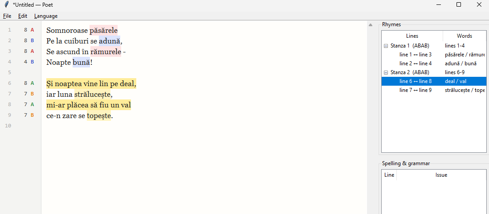

# Poet — poetry assistant

A lightweight desktop editor that analyses your poem as you type, in **English** or **Romanian**:




- **Spelling** — unknown words underlined in red, with suggestions (right-click to replace, add to dictionary or ignore). Mid-line capitalised words are treated as names and skipped.
- **Grammar** — unambiguous slips underlined in blue, deliberately conservative because poetry bends grammar on purpose. Common to both languages: doubled words, spacing around punctuation, lowercase after a full stop.
  - English: *a/an* (by pronunciation: *an hour*, *a unicorn*), lowercase *i*, *could of*, *he don't*, *they was*, *more then*, *it's own*.
  - Romanian: *ar fii* → *ar fi*, *mi-ar place* → *mi-ar plăcea*, *să aibe/deie/steie*, *cel mai optim*.
- **Syllables per line** — in the left gutter. English words with variant pronunciations show a range (*temperate* → `9-10`).
- **Rhymes** — each stanza (block separated by blank lines) gets a rhyme scheme (`ABAB`…). The gutter shows the letter, rhyming end words are colour-tinted by group, and the *Rhymes* panel lists which line rhymes with which. The status bar shows the current line's syllables and rhyme partners.
- **Languages** — *Language → Poem language* picks the analysis language; *Language → Interface language* translates menus, panels and messages. Both are remembered; the interface defaults to the OS language.

## Run

Requires Python 3.10+ with Tk (bundled with the python.org installers; on Linux `apt install python3-tk`).

```bash
git clone https://github.com/OWNER/REPO.git
cd REPO
python -m pip install -r requirements.txt
python main.py [poem.txt]
```

Run the tests with `python -X utf8 -m unittest discover tests`.

All dependencies are pure Python. Without them the app still runs and says what is missing: English syllables and rhymes fall back to spelling heuristics, and spell-checking turns off for a language with no word list.

| Package | Used for |
|---|---|
| `cmudict` | English pronunciations: syllables, rhymes, *a/an* |
| `pyspellchecker` | English spelling and suggestions |
| `spylls` | Romanian spelling (reads the bundled Hunspell dictionary) |

Shortcuts: Ctrl+N/O/S, Ctrl+Shift+S, F8 / Shift+F8 next/previous issue, Ctrl+mouse wheel to zoom, Alt+first letter opens a menu. Double-click an issue to jump to it with its suggestions.

## Architecture

```
poet_core/              portable, no GUI/OS imports: text in, plain dataclasses out
  model.py              Report, LineInfo, Stanza, RhymePair, Issue
  analyzer.py           Analyzer(language, ui_language).analyze(text) -> Report
  i18n.py               translated strings for messages *and* frontend labels
  samples.py            demo poem per language
  text.py               tokenising, stanza splitting
  rhyme.py              rhyme-scheme assignment per stanza (language-neutral)
  grammar_common.py     rule scaffolding + language-neutral rules
  spelling_common.py    user dictionary, ignore list, suggestion cache
  lang/__init__.py      language registry
  lang/en/              CMU-dictionary phonetics, pyspellchecker, English rules
  lang/ro/              letter-based phonetics, Hunspell via spylls, Romanian rules
  lang/ro/data/         rospell ro_RO dictionary (GPL/LGPL/MPL, see LICENSE there)
poet_tk/                Tkinter frontend (the only GUI/OS-specific code)
  os_support.py         config dir, OS language, fonts, modifier keys, wheel/right-click per OS
  settings.py           remembered languages (settings.json in the config dir)
  app.py                window, gutter, panels, menus, debounced background analysis
main.py
tests/                  core unit tests: python -m unittest discover tests
```

### How Romanian is analysed

Romanian spelling is close to pronunciation, so syllables come from letters: vowel runs split into diphthongs/triphthongs (*oa*, *ea*, *ioa* = one syllable) or hiatus (*po-e-zi-e*), and a final *-i* after a consonant is silent (*pomi*, *dormi*, *dă-mi*). Hyphenated clitics count as one word (*s-a*, *într-o*, *florile-n*).

Stress, where a rhyme starts, isn't written, so it is guessed: words ending in a single vowel are stressed on the next-to-last syllable (*floare*, *adună*), others on the last (*pământ*, *cafea*, *copaci*); a definite article doesn't move it (*cerul*, *codrului*). The rhyme runs from the stressed vowel to the end, so *soare / mare* rhyme. Writing an accent (*fáce*) overrides the guess.

### Porting to another GUI

Everything a frontend needs is `Analyzer("ro", ui_language="ro", user_dictionary=path).analyze(text) -> Report`:

- `report.lines[i]` — `syllables_text`, `rhyme_label`, `rhyme_group` (stable id for colouring), `rhymes_with`, `end_word_span`
- `report.stanzas` — `scheme` and `pairs`
- `report.issues` — `kind`, `line`, `start`, `end` (0-based, per line), `message` (in the UI language), `code`, `suggestions`
- `report.incomplete` — some suggestions were skipped to stay fast; analyse again to fill them in (Romanian suggestions take up to ~0.5 s each the first time)
- `analyzer.spelling.add_to_dictionary(word)` / `.ignore(word)`, `analyzer.missing_data()`
- `poet_core.i18n.t(key, lang)` for labels, so a new frontend reuses the translations

`analyze` is safe to call from a worker thread; the Tk app debounces keystrokes (250 ms) and runs it off the UI thread. A Qt, web (Pyodide), or CLI frontend only reimplements what's in `poet_tk/`.

### Adding a language

Create `poet_core/lang/<code>/` with phonetics (`syllable_range`, `rhyme_keys`), a speller (subclass `BaseSpeller`) and a grammar checker, register it in `lang/__init__.py`, and add its strings to `i18n.py` and a sample to `samples.py`. Adding only an *interface* language needs just a new `i18n.CATALOG` entry and its code in `UI_LANGUAGES`.

### Swapping the grammar engine

Pass any object with `check(lines: list[str]) -> list[Issue]`, e.g. an adapter over LanguageTool:

```python
Analyzer("en", grammar=MyLanguageToolAdapter())
```

## Limitations

- Rhymes are *perfect* rhymes (same sounds from the last stressed vowel), plus identical words. Slant/eye rhymes (*love/prove*, *temperate/date*) are not paired.
- English syllable counts follow dictionary pronunciation; poetic elision (*heav'n*) is respected when written with an apostrophe.
- Romanian stress is a heuristic: words stressed on the third-to-last syllable (*pasăre*, *lacrimă*) or final-stressed words ending in a vowel (*așa*) get the wrong rhyme start. Elision across words (*se_ascund*) is not applied to counts.
- The poem language is chosen manually; there is no automatic detection.

## License

MIT, see [LICENSE](LICENSE). The bundled Romanian dictionary ([rospell](http://rospell.sourceforge.net), via [wooorm/dictionaries](https://github.com/wooorm/dictionaries)) keeps its own license, GPL-2.0 OR LGPL-2.1 OR MPL-1.1: see [poet_core/lang/ro/data/LICENSE](poet_core/lang/ro/data/LICENSE). The Romanian sample poem is by Mihai Eminescu (public domain).
